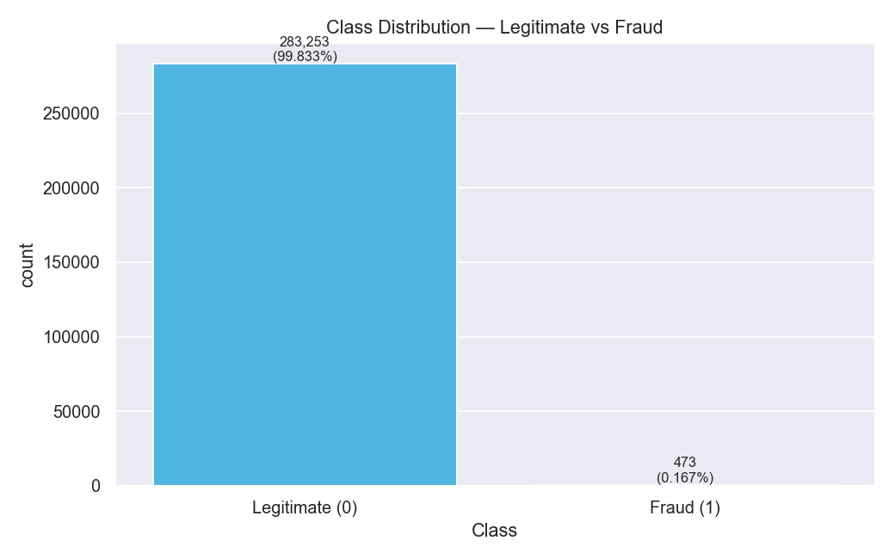

# FraudShield AI — Intelligent Financial Fraud Detection System

A complete, runnable academic mini-project that detects potentially fraudulent
credit-card transactions with machine learning, serves predictions through a
FastAPI backend, and visualises real evaluation results in a React dashboard.

> **Academic use only.** Every prediction is a *model output*, not confirmed
> fraud. The system never blocks payments and must not be presented as a
> production fraud system.



---

## 1. Problem statement

Credit-card fraud is extremely rare (~0.17 % of transactions) but expensive.
A useful detector must flag as many genuine frauds as possible (high recall)
while keeping false alarms manageable (adequate precision). Naïve accuracy is
meaningless: predicting "legitimate" for everything scores 99.83 % accuracy
and catches zero fraud.

## 2. Objectives

1. Load and strictly validate the public Kaggle `mlg-ulb/creditcardfraud` dataset.
2. Prevent data leakage with stratified splits made *before* any fitting.
3. Train and fairly compare three imbalance-aware classifiers.
4. Select the best model by validation **PR-AUC** and tune its decision
   threshold on validation data only.
5. Evaluate once on a held-out test set and publish all metrics honestly.
6. Serve single / batch / CSV predictions via a documented FastAPI service.
7. Present real evaluation artifacts in an interactive analyst dashboard.

## 3. Features

- **Backend (FastAPI)** — `POST /api/predict`, `/api/predict/batch`,
  `/api/predict/csv`, `GET /api/model-info`, `/api/analytics/*`,
  `/api/samples`, `/health`, interactive Swagger docs at `/docs`.
- **Frontend (React + TypeScript + Tailwind + Recharts)** — five pages:
  Dashboard, Transaction Analyzer (with real held-out sample loader and
  local feature-contribution explanations), Batch Analysis (CSV upload,
  validation, results export), Model Performance (curves, comparison table,
  threshold explanation), and About.
- **ML pipeline** — Logistic Regression, Random Forest and Balanced Random
  Forest; reproducible seeds; artifacts saved under `artifacts/`.
- **12 evaluation/EDA figures** under `reports/figures/`.

## 4. Technology stack

| Layer | Tools |
|---|---|
| ML / data | Python 3.10+, pandas, NumPy, scikit-learn 1.7, imbalanced-learn 0.14, joblib |
| Plots | matplotlib, seaborn |
| Backend | FastAPI, Pydantic v2, uvicorn |
| Frontend | React 18, TypeScript, Vite 5, Tailwind CSS 3, Recharts, lucide-react |
| Tests | pytest, httpx (TestClient), `tsc` + Vite production build |

## 5. Dataset

**Kaggle — Credit Card Fraud Detection (MLG-ULB):**
<https://www.kaggle.com/datasets/mlg-ulb/creditcardfraud>

284,807 European cardholder transactions (2 days, Sept 2013), 492 fraud cases
(1,081 exact duplicate rows exist; after removing them the training data is
283,726 rows with 473 frauds).
Columns: `Time`, `V1…V28` (anonymised PCA components), `Amount`, `Class`
(0 = legitimate, 1 = fraud).

### Download

```bash
# Option A — Kaggle CLI
kaggle datasets download -d mlg-ulb/creditcardfraud -p data/raw --unzip

# Option B — manual
#   1. Download from the Kaggle link above (free account required)
#   2. Extract and place creditcard.csv into data/raw/
```

Verify: `python scripts/download_dataset.py --instructions` prints the full
guide. The raw file is git-ignored (150 MB, Kaggle licence).

**Cannot download?** Train a clearly-labelled synthetic **demo** model:

```bash
python scripts/train.py --demo
```

The demo is stamped `data_source="demo-synthetic"` in every artifact and the
UI shows a permanent warning banner. It is never presented as real performance.

## 6. Installation

```bash
# Python backend
python -m venv .venv
.venv\Scripts\activate        # Windows
# source .venv/bin/activate   # Linux/macOS
pip install -r requirements.txt

# Node frontend
cd frontend
npm install
cd ..
```

## 7. Training

```bash
python scripts/train.py          # real dataset (data/raw/creditcard.csv)
python scripts/train.py --demo   # synthetic demo fallback
```

This performs EDA, writes 12 figures, trains three models, selects by
validation PR-AUC, tunes the threshold on validation, evaluates once on the
test set, and writes everything to `artifacts/`:

| Artifact | Contents |
|---|---|
| `model_pipeline.joblib` | fitted preprocessor + selected model (the exact pipeline used at inference) |
| `model_metadata.json` | version, training date, threshold, feature schema, split sizes |
| `model_comparison.json` | per-model validation metrics + test metrics of the winner |
| `evaluation_metrics.json` | ROC/PR curves, threshold sweep, confusion matrices |
| `feature_importance.json` | MDI importances or standardized coefficients |
| `dataset_stats.json` | real dataset statistics shown on the dashboard |
| `sample_transactions.json` | real held-out rows for the demo loader |

## 8. Running the application

```bash
# Terminal 1 — API (http://localhost:8000, docs at /docs)
python -m uvicorn backend.app.main:app --reload --port 8000

# Terminal 2 — UI (http://localhost:5173)
cd frontend
npm run dev
```

Open <http://localhost:5173>. The Vite dev server proxies `/api` to port 8000;
CORS is additionally enabled for `http://localhost:5173` only.

## 9. API documentation

Swagger UI: <http://localhost:8000/docs> · ReDoc: <http://localhost:8000/redoc>

| Method | Path | Purpose |
|---|---|---|
| GET | `/` | API info |
| GET | `/health` | App + model readiness |
| GET | `/api/model-info` | Version, threshold, feature schema, tuning method |
| POST | `/api/predict` | Score one transaction (30 features) |
| POST | `/api/predict/batch` | Score 1–1000 JSON transactions |
| POST | `/api/predict/csv` | Score an uploaded CSV (labels ignored, bad rows reported) |
| GET | `/api/samples` | Real held-out sample transactions |
| GET | `/api/analytics/overview` | Dataset + headline test metrics |
| GET | `/api/analytics/model-comparison` | All models' validation metrics |
| GET | `/api/analytics/confusion-matrix` | Test-set confusion matrix |
| GET | `/api/analytics/feature-importance` | Importances / coefficients |
| GET | `/api/analytics/curves?split=validation\|test` | ROC & PR curve data |

Example:

```bash
curl -X POST http://localhost:8000/api/predict \
  -H "Content-Type: application/json" \
  -d '{"Time":50000,"V1":-1.2,"V2":0.8,"V3":-2.1,"V4":1.3,"V5":-0.5,"V6":0.2,"V7":-0.3,"V8":0.1,"V9":-0.7,"V10":-1.5,"V11":0.9,"V12":-2.0,"V13":0.3,"V14":-1.8,"V15":0.2,"V16":-0.9,"V17":-2.5,"V18":0.4,"V19":0.1,"V20":0.3,"V21":0.1,"V22":0.0,"V23":-0.1,"V24":0.2,"V25":0.0,"V26":0.1,"V27":0.0,"V28":0.0,"Amount":120.5}'
```

## 10. Testing

```bash
python -m pytest backend/tests -q     # 56 automated tests (no dataset needed)
cd frontend && npm run build          # type-check + production build
```

Tests use a small deterministic synthetic fixture so they never retrain the
production model or require the 150 MB dataset.

## 11. Results (real, from this repository's training run)

Trained on the real Kaggle dataset (283,726 rows after removing 1,081 duplicate
rows, of which 473 are fraud; 60/20/20 stratified split, seed 42):

**Validation-set comparison (all models, threshold 0.5):**

| Model | PR-AUC | ROC-AUC | Precision | Recall | F1 | FP | FN | Train |
|---|---|---|---|---|---|---|---|---|
| Logistic Regression | 0.787 | 0.979 | 0.054 | 0.904 | 0.102 | 1,494 | 9 | 2.0 s |
| **Random Forest (selected)** | **0.875** | 0.961 | 0.918 | 0.830 | 0.872 | 7 | 16 | 158 s |
| Balanced Random Forest | 0.778 | 0.970 | 0.051 | 0.904 | 0.097 | 1,580 | 9 | 13 s |

The log/balanced-forest models have very high recall but almost no precision at
the default 0.5 cut-off; the Random Forest dominates on both PR-AUC and F1 and
is selected by the documented criterion (validation PR-AUC).

Selected model: **Random Forest**, threshold **0.2997** (tuned on the validation
split to maximise F1, ties broken toward recall).

**Held-out test set (56,746 transactions, 95 frauds) at threshold 0.2997:**

| Metric | Value |
|---|---|
| Precision | 0.934 |
| Recall (fraud detection rate) | 0.747 |
| F1 | 0.830 |
| PR-AUC | 0.811 |
| ROC-AUC | 0.944 |
| Confusion matrix | TN 56,646 · FP 5 · FN 24 · TP 71 |
| Risk distribution | low 56,659 · medium 11 · high 76 |

For reference, at the default 0.5 threshold the same model scores precision
0.971 / recall 0.705 (2 false positives, 28 missed frauds) — showing the
cost-sensitivity trade-off the threshold tuning makes explicit.

*(Re-running `python scripts/train.py` reproduces these numbers exactly — all
seeds are fixed.)*


## 12. Screenshots

Add your own screenshots before submission:

| Page | Screenshot |
|---|---|
| Dashboard | `docs/screenshots/dashboard.png` |
| Analyzer | `docs/screenshots/analyzer.png` |
| Batch | `docs/screenshots/batch.png` |
| Performance | `docs/screenshots/performance.png` |
| Swagger docs | `docs/screenshots/swagger.png` |

## 13. Known limitations

- Two days of 2013 European data — limited external validity.
- V1–V28 are anonymised PCA components; explanations are statistical
  associations only, never causes.
- Probabilities are **not calibrated** — treat them as rankings.
- No demographic info exists in the dataset, so fairness audits are impossible.
- The demo (`--demo`) model has no real-world meaning.

## 14. Project structure

```
FraudShield-AI/
├── backend/
│   ├── app/
│   │   ├── main.py               # FastAPI app factory
│   │   ├── api/                  # prediction + analytics routers
│   │   ├── schemas/              # Pydantic request/response models
│   │   ├── services/             # model loading, inference, CSV parsing
│   │   └── core/                 # config, dataset validation
│   └── tests/                    # 56 pytest tests + fixtures
├── frontend/
│   └── src/{components,pages,services,types}
├── data/{raw,processed}/         # dataset (git-ignored) + split manifest
├── artifacts/                    # trained pipeline + metrics JSON
├── scripts/                      # train.py, download_dataset.py
├── reports/figures/              # 12 PNG evaluation/EDA plots
├── docs/                         # VIVA_QUESTIONS.md, screenshots/
├── PROJECT_REPORT.md · MODEL_CARD.md · RUN.md
└── requirements.txt
```

## 15. Licence & credits

Dataset © Machine Learning Group (MLG-ULB), Université Libre de Bruxelles,
released on Kaggle for research. This project is an academic exercise; see
`MODEL_CARD.md` for intended use and prohibited interpretations.
